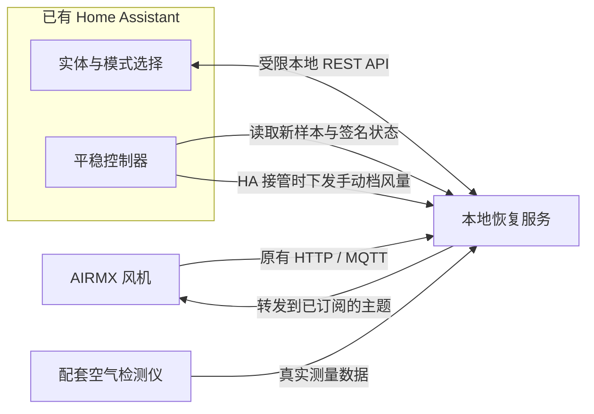

# 架构与适用范围

## 数据与控制路径

本地服务替代设备依赖的部分通信接口，保留风机与检测仪之间的数据链。HA 通过受限 API 读状态和控制，平稳控制器在 HA Core 的短任务中运行。BLE 配网页仅在需要重新配置 Wi-Fi/登记时使用。

## 支持到哪一层

| 层面 | 已知适用范围 |
|---|---|
| 设备 | AIRMX PRO 与配套检测仪的已观察协议；其他机型/固件需核对 |
| 设备通信 | 已确认的明文 HTTP、MQTT 3.1/3.1.1；不能直接套到 TLS/HTTPS/8883 |
| 标准部署 | OpenWrt 网关运行本地服务，按设备来源与旧目的地址精确转发 |
| 其他主机 | NAS/普通 Linux 可运行 Python 服务，DNAT 和来源保留需自行适配 |
| HA | 使用已有实例；不要求另外安装一个 HA |
| 远程网络 | 默认执行电脑已在内网，不要求特定 VPN 或远程接入软件 |

模板针对一台风机及一台配套检测仪，窄范围 MQTT 实现不作为全网通用 broker 使用。先观察自己的主题、设备 ID 和实际连接地址；不要把示例身份套到另一台设备。

## 两种智能控制

- **原生 AI**：风机收到真实检测仪数据后，由固件自行调速。HA 可观察和切换模式。
- **HA 平稳智能**：由本地控制器根据空气数据调速，风机使用手动协议档位。helper 选择与设备回报应分别显示。

两者不能同时作为调速方。关机或检测到人工改变模式/风量后，HA 暂停；通过正常模式选择明确恢复控制。不能定时强行重新应用模式来抢回控制。

## 从身份到执行确认

MQTT CONNECT 的密码仅作为签名 key 候选，验证风机状态后才保存。HTTP genId 也可登记设备声明，因此 `registered=true` 只表示存有登记信息，不等于已经验签。控制还要求在线、订阅匹配、状态签名有效且时间新鲜。

下发命令成功和执行成功分开判断。控制确认需要请求后的新鲜回报，不能拿旧缓存值匹配目标就算确认。完成确认后若新的有效回报显示人工接管，应立即暂停；尚未确认时的宽限期不能用于覆盖已发生的人工操作。

检测仪网络上报约五分钟一次；内部探头采样频率未知。HA 每 30 秒读取和每分钟调度只是在查看缓存，普通调节只能消耗真实新样本。

## 部署与维护边界

本地 API 限定明确监听地址、HA 来源和 Bearer token；管理端只绑定回环。数据目录和凭据使用受限权限，不把 key、token、完整认证报文或私人抓包放入日志、截图或公开仓库。

服务与转发规则分别持久化，不能只启动 Python 进程就认为整条链路已恢复。修改前保留可回退配置；更新控制器时使用锁和原子替换，通常保留当前学习状态与人工接管标志。

## 完成验收

分别记录设备身份、风机与检测仪连接、有效签名状态、真实空气新样本、HA 实体、控制后的真实回报，以及防火墙重载恢复。需要实际整机重启测试时，再记录重启后的相同结果。

智能策略更新需通过离线回归，并确认更新后的程序处理了真实新样本。低负荷保持 9%、或固定历史输入的离线回放，不能代替高占用、高浓度及断线场景的实测验证。
